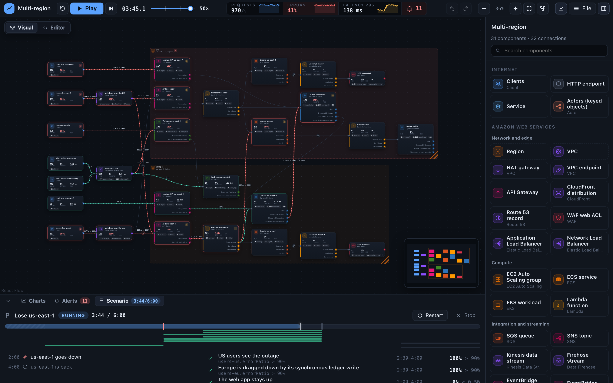
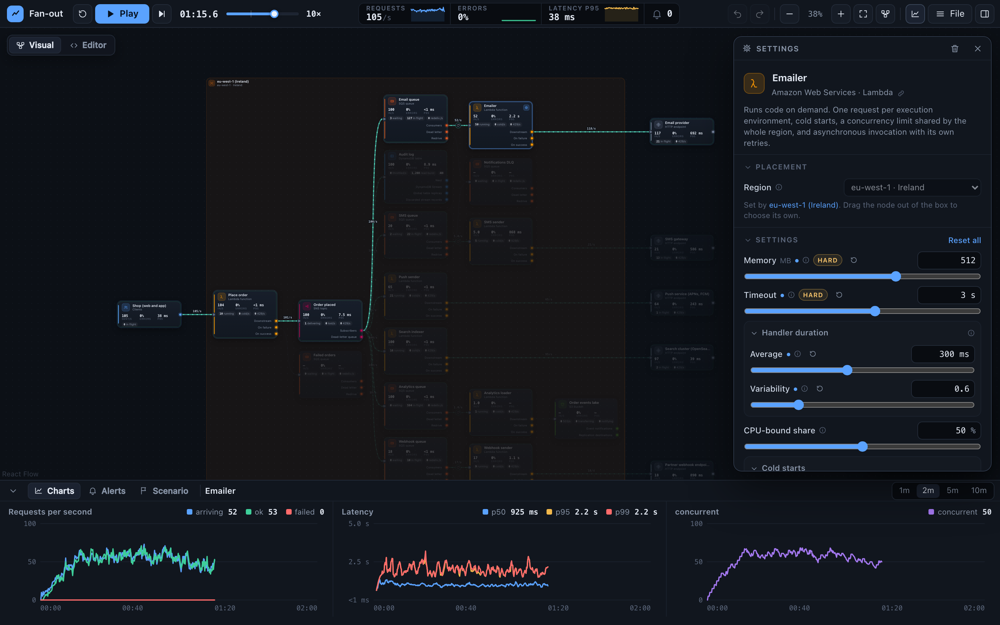
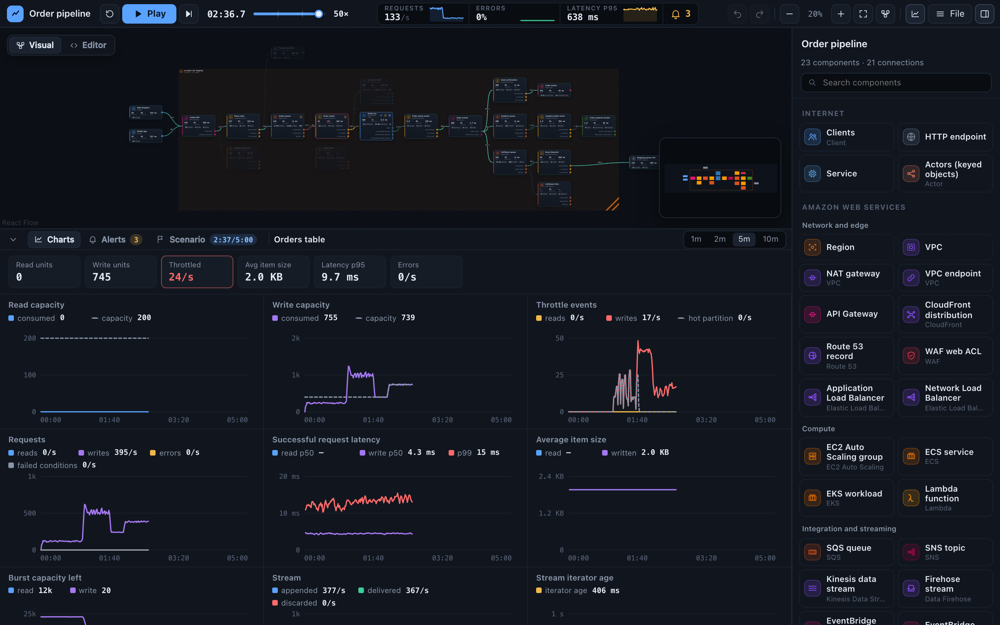
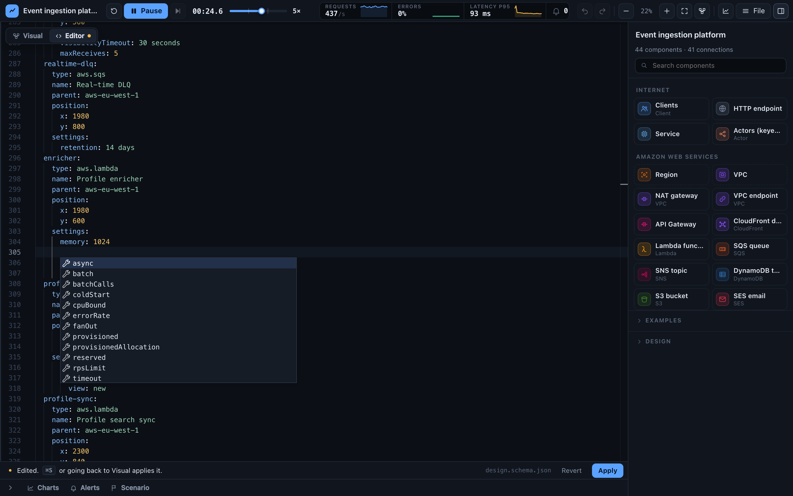

# infra-sim

[](https://robertpitt.github.io/infra-sim/)

**[Open the live demo →](https://robertpitt.github.io/infra-sim/)** Nothing to install: the whole simulator runs in your browser. Pick an example from the sidebar, press play, and break something.

Simulate cloud infrastructure under traffic and faults. Draw a design (load balancers and Auto Scaling groups, containers on ECS and EKS, Lambda, queues, streams and event buses, databases, caches and search, regions and availability zones, outside services), press play, and watch where it scales, where it pushes back, and where it falls over: throttling cascades, retry storms, redelivery loops, scale-out that comes too late, a zone or a region going down. AWS first, using AWS's published limits (each one marked **hard**, an adjustable **quota**, or **assumed**), with the structure to add other providers.

The engine is pure [Effect](https://effect.website) (`src/simulator`, no DOM) and runs in a Web Worker in the browser; the UI (`src/ui`) is a client of it. How it works, and why it is fast: [SIMULATOR.md](SIMULATOR.md). Where every number comes from: [docs/AWS-LIMITS.md](docs/AWS-LIMITS.md).

<a href="https://robertpitt.github.io/infra-sim/"></a>

<sub>The Multi-region example playing its <em>Lose us-east-1</em> scenario, 105 seconds in. The US region is down, and European orders fail with it because their handler writes to the US ledger synchronously. What was built for it holds: the website stays up as CloudFront, a global service, fails over to the European bucket, and European lookups read the global table's European replica. Route 53, global too, has noticed the outage and is moving US users to Europe as resolvers' caches expire, but their orders fail there as well, at the same ledger. The header shows what the clients see (41% errors, eleven alerts firing); the scenario panel shows the outage on its timeline and the checks it makes.</sub>

## A quick tour

**Break things and watch.** The examples ship with scenarios: a timeline of faults and changes (lose a region, slow a dependency, triple the traffic) and the checks that must hold. Play one and watch it unfold at up to 100× speed; the run stops at the end with a verdict. Standard alarms (errors, throttling, timeouts, dead letters, old backlogs, saturation) watch every component and show where it hurts.

**Configure it while it runs.** Select a component and the path it is on lights up. Its gear, or a double-click, opens its settings, as sliders; where the provider publishes a limit, the slider stops at it and says whether it is *hard* or an adjustable *quota*. The charts underneath show the effect as you drag.



**Read it the way you would read CloudWatch.** Select a component or a connection and the dock shows its dashboard: its key figures, and the charts an operator would put up for that service, named after the metrics AWS publishes. A DynamoDB table shows consumed against provisioned capacity, read and write throttle events, latency and average item size. A Lambda function shows invocations, errors, throttles, duration and concurrency against the regional quota. A queue shows the messages visible and the age of the oldest. Hover a chart's title for the CloudWatch metrics it stands for. Charts are drawn in steady, clock-aligned steps, so they don't jitter as the run plays.



**Designs are YAML, checked as you type.** The *Editor* tab shows the design as YAML, with completion, hover help and validation from the design's JSON Schema: the same schema VS Code uses for design files. Edits apply with ⌘S or when you go back to the canvas, as one undoable change.



## What it simulates

Each AWS service has its own README in [`src/simulator/aws/`](src/simulator/aws): what is simulated and what isn't yet, every limit with its source, and what is assumed.

| | |
| --- | --- |
| **Network and edge** | Regions and availability zones, VPCs, NAT gateways and VPC endpoints, API Gateway, CloudFront, Route 53, WAF, Application and Network Load Balancers |
| **Compute** | Lambda, EC2 Auto Scaling, ECS (Fargate and EC2 capacity providers), EKS (managed node groups, the Cluster Autoscaler and Karpenter) |
| **Integration and streaming** | SQS, SNS, EventBridge and EventBridge Scheduler, Step Functions, Kinesis Data Streams, Amazon Data Firehose, SES |
| **Data** | DynamoDB, S3, RDS and Aurora with RDS Proxy, ElastiCache (Valkey, Redis OSS, Memcached), OpenSearch |
| **Anywhere** | Traffic sources, outside HTTP services, plain services and actors (for a system with no cloud at all), and a target-tracking autoscaler for any of them |

Faults: an outage, errors or slowness on a component, an edge, a region or one availability zone; black holes and packet loss on an edge; some of a fleet's instances, tasks or pods crashing.

## Examples

Each is a design in [`examples/`](examples) with scenarios to play, in the app or as `@<id>` on the command line.

| Example | What it shows |
| --- | --- |
| Event ingestion platform | A customer-data platform on Kinesis, Firehose and OpenSearch: a launch, a CRM outage only the destinations notice, an under-provisioned profiles table |
| URL shortener | CloudFront shielding redirects while clicks stream through Kinesis: a viral link, a bulk import using up a partner's quota, a bad deploy of the counter |
| Order pipeline | A flash sale outrunning a provisioned table, SES at its starting quota, a shipping partner down |
| Retry storm | Retries three layers deep turning sixty shoppers a second into a thousand calls on a slow provider, and the timeouts that tame them |
| Multi-region | Losing a region: what CloudFront failover, global tables and Route 53 save, and what one synchronous cross-region write loses |
| Fan-out | SNS keeping each subscriber's trouble its own: a mail provider down, partner webhooks down, SMS throttled, a search backfill |
| Autoscaled cluster | No cloud at all: replicas that take time to start, two autoscalers on different metrics, a slow database |
| Order saga | A Step Functions saga with compensation and an EventBridge fan-out: a payment outage, a loyalty partner down, a flash sale against the workflow quotas |
| Clickstream analytics | A hot shard more shards can't fix, a poison record blocking a shard, Firehose buffer sizes against object counts |
| Product catalog and search | A nightly reindex starving search, a celebrity product on one cache shard, an Aurora failover, a lost availability zone |
| Multi-tenant SaaS API | WAF against credential stuffing, 40,000 tenants' midnight jobs against a flexible time window, RDS Proxy through a failover |
| Three-tier web shop on EC2 | An Auto Scaling group behind an ALB over three zones: losing a zone, a surge against a warm pool, the vCPU quota |
| Ticketing on ECS Fargate | Services on Fargate behind an ALB: an on-sale rush against slow image pulls and lazy loading, a bad deploy the circuit breaker rolls back, a Fargate Spot wave on a worker scaled by its queue's backlog |
| Kubernetes on EKS | Two-level scaling: the Cluster Autoscaler against Karpenter in a flash sale, a lost zone's slow eviction, a rollout that stalls |

## Quick start

Needs Node 22 or newer (`.nvmrc` pins 22).

```sh
npm install
npm run dev        # http://localhost:5173
```

| Command | |
| --- | --- |
| `npm run dev` | The app with hot reload. Editing a component restarts the running simulation with the same design. |
| `npm run build` | Cleans and builds the app to `dist/`: static files with relative paths, so they work from any URL. |
| `npm run preview` | Serves `dist/` locally. |
| `npm test` | The test suite (vitest). |
| `npm run typecheck` | Type-checks the engine (with no DOM types), the command line and the app, with the Effect diagnostics. |
| `npm run cli -- <command>` | The command line: run, check, import, describe. See below. |
| `npm run build:cli` | Bundles the command line to `dist-cli/infra-sim.mjs`. |
| `npm run bench -- ingestion 60000 10` | CPU cost of simulating an example, at a multiple of its traffic. See `tools/`. |
| `node tools/screenshots.mjs` | Retakes the README's screenshots from the running app (`npm run dev` first; or `URL=<site>` to use the live demo). |

`tsc` is TypeScript 7 (the native compiler), patched by [`@effect/tsgo`](https://github.com/Effect-TS/tsgo) on `npm install` to include the Effect language service. Effect warnings and errors (floating effects, unhandled requirements, chained `Effect.provide`, …) fail `npm run typecheck`. Suggestions only appear in the editor. The plugin is configured in `tsconfig.json`. To see the same diagnostics in VS Code or Cursor, install the recommended extensions (TypeScript Native Preview and Effect) from `.vscode/extensions.json`. `.vscode/settings.json` already points the editor at the workspace compiler. How to write code here: [AGENTS.md](AGENTS.md).

## Deployment

Every push to `main` runs the typecheck and tests, builds the app, and publishes `dist/` to GitHub Pages ([`.github/workflows/pages.yml`](.github/workflows/pages.yml)): https://robertpitt.github.io/infra-sim/. One-time setup: in the repository's **Settings → Pages**, set **Source** to **GitHub Actions**.

## Designs are files

YAML is the primary format; JSON works everywhere YAML does. **File ▸ Open** (⌘O) reads either, **File ▸ Save** (⌘S) writes YAML, and **Save as JSON** is there for tools that want it. The [`examples/`](examples) folder holds the designs that ship with the app, in the same format.

```yaml
# yaml-language-server: $schema=https://robertpitt.github.io/infra-sim/schema/design.schema.json
version: 1
name: Order pipeline
description: Clients call an API that runs a function.   # the first paragraph is the blurb
seed: 7                         # the same design and seed always play out identically
nodes:
  web:
    type: common.client
    position: {x: 0, y: 60}
    settings: {rps: 120}        # only what you change; the rest takes the documented default
  eu:
    type: aws.region            # a box: whatever is inside runs in this region
    position: {x: 300, y: 0}
    size: {w: 760, h: 240}
    settings: {region: eu-west-1}
  api:
    type: aws.apigateway
    parent: eu
    position: {x: 330, y: 60}
    settings: {apiType: http}
  handler:
    type: aws.lambda
    parent: eu
    position: {x: 700, y: 60}
    settings: {memory: 512, duration: {mean: 80}}
edges:
  web-api: {from: {node: web}, to: api, settings: {retry: {maxAttempts: 3}}}
  api-handler: {from: {node: api}, to: handler}
```

Add a file to `examples/` (a numeric prefix sets the order) and it appears in the app. Settings are validated against each component's schema, with every problem reported by its location, e.g. `nodes.api.settings.apiType`.

**Editor support.** Designs have a JSON Schema, generated from the components ([`schema/design.schema.json`](schema/design.schema.json), published at the URL in the first line above; scenario files have [`scenario.schema.json`](schema/scenario.schema.json)). That first line points the YAML language server at it, so VS Code (with the Red Hat YAML extension) completes component types and each component's own settings, shows their ranges, defaults and meaning on hover, and marks typos and out-of-range values as you type. Files the app and the CLI write carry the line; `$schema` does the same in JSON. `npm run schema` regenerates the files after a component changes (a test fails until you do), and `infra-sim schema` prints them.

In the app, the canvas has two tabs at its top left: **Visual**, the diagram, and **Editor**, the design as YAML in an editor driven by the same schema (plus the simulator's own checks, such as an edge to a node that doesn't exist). Edits are a draft until ⌘S or going back to Visual applies them, as one undoable change. Select a node or connection and a gear appears on it: it (or a double-click) opens its settings in a dialog over the canvas, so the sidebar stays the component picker.

## Importing existing infrastructure

**File ▸ Import** turns infrastructure someone else described into a design, and shows a report of what became of every part of it. **File ▸ Open** recognises these files too, so dropping a CloudFormation template into Open works.

| Importer | Reads |
| --- | --- |
| CloudFormation | CloudFormation templates, AWS SAM, and `cdk synth` output, as YAML or JSON |

For CloudFormation it carries over what the template says, service by service:

- **Lambda**: memory, timeouts, reserved and provisioned concurrency (also from versions and aliases), SnapStart, retries and maximum event age, success and failure destinations, dead-letter targets, function URLs, and the VPC a function is attached to.
- **SQS**: FIFO, visibility timeout, retention, delay, redrive, high throughput, content-based deduplication, and what a consumer reads with (batch size and window, maximum concurrency, provisioned pollers).
- **SNS**: FIFO, throughput scope, deduplication, maximum message size, and per subscription raw delivery, redrive to a dead-letter queue, retry and throttle from the delivery policy.
- **DynamoDB** (tables, global tables, SAM `SimpleTable`): billing mode and capacity, on-demand maximum and warm throughput, global and local indexes, the stream view and every function reading the stream (batching, parallelization, record age, retries, bisecting, discarded batches), and a global table's replicas as one table per region box.
- **S3**: versioning, directory buckets, event notifications (event types, the share a key filter lets through), replication and Replication Time Control.
- **API Gateway** (REST, HTTP, SAM): API type and endpoint type, integrations and timeouts, MOCK integrations, stage throttling, the stage cache, usage plans, Lambda, JWT, Cognito and IAM authorizers, and the number of routes.
- **CloudFront**: each origin (S3 or custom, failover groups, Origin Shield, timeouts), the default behavior's cache policy, compression and methods, price class, edge functions and error caching.
- **SES**: configuration sets (suppression, delivery window), event destinations to SNS with the event types they match, and the functions allowed to send mail.
- **VPC**: VPCs with a subnet plan, NAT gateways, VPC endpoints, and the functions placed inside.

It resolves parameters, mappings and conditions on the way. It draws the wiring the template states (event source mappings, SNS subscriptions, S3 notifications and replication, API integrations, CDN origins, EventBridge rules, SAM events, dead-letter targets) and the wiring it implies: a function that names a queue, table or configuration set in an environment variable or its own policies is taken to use it, with reads and writes told apart. Everything AWS goes inside a region box (a VPC's functions inside the VPC's box), and traffic sources are added where something is called from outside, at an assumed rate; viewers of a CloudFront distribution read, so something is cached.

A template can't say how long a handler takes or how much traffic there is, so those keep their defaults and the report says so. Resources with no component yet (OpenSearch, Kinesis, ECS...) are listed, never dropped quietly; permissions and logging are listed separately because they don't change behaviour under load. What a template says that the simulator can't represent (a filter policy, partial batch responses, extra cache behaviors, a TTL's rate, the share of objects a key filter lets through) is reported as a warning or an assumption, and values the template computes at deploy time, or that the simulator doesn't accept, are reported rather than guessed. Try it with [`examples/imports/`](examples/imports).

## Command line

Everything the app does with a design, from a terminal, a script, CI or an agent: run it, break it, assert on the result.

```sh
npm run cli -- examples                                  # what ships with it
npm run cli -- run @orders -d 5m --scale 3               # a design, at three times the traffic
npm run cli -- run @multi-region -d 6m \
    --fault "region:aws:us-east-1 Outage at=2m for=2m" \
    --assert "users-us.errorRatio < 5%"                  # exit 1 if it doesn't hold
npm run cli -- run @multi-region --scenario lose-us-east-1 --json
npm run cli -- describe aws.lambda                       # every setting, range, and hard limit vs quota
npm run cli -- run --help                                # flags and examples for any command (also --version, --completions zsh)
npm run build:cli                                        # dist-cli/infra-sim.mjs: one file, Node 22+, the `infra-sim` bin
```

A **scenario** is what happens to a design: duration, traffic, setting overrides, a timeline of faults and live changes, and
assertions (`api.errorRatio < 1%`, `orders-queue.gauge.depth:max < 5000`, `system.latency.p99 < 800ms`). A design carries
the scenarios written for it under `scenarios` (every example has some: a link going viral, a retry storm, a lost region or zone, a provider outage, a
traffic surge), and `--scenario <id>` plays one; a scenario can also be a file of its own that names its design.
The app plays the open design's scenarios live (the dock's **Scenario** tab): the timeline happens at its times, each check shows whether
it is holding, and the run stops at the end with a verdict. Every run is also watched by standard **alarms** (errors,
throttling, timeouts, dead-lettered and expired messages, old backlogs, saturation), shown in the **Alerts** tab and on the
nodes, and listed in the CLI's report.
Runs are on virtual time and deterministic, so a simulated hour takes seconds and the same seed gives the same result. Exit
codes: `0` held, `1` an assertion failed, `2` the input was wrong. `--json` prints the whole result as data. The guide for
people and agents, with the scenario format, assertion syntax and output schema, is [`docs/CLI.md`](docs/CLI.md) (also
`infra-sim docs`). The command line is built with [`effect/cli`](https://effect.website), which provides `--help`,
`--version`, shell completions and flag errors.

## Layout

```
src/simulator/   the engine: pure Effect, no DOM. Components, edges, faults, virtual time, the Engine protocol, importers
src/cli/          the command line (Node only): a thin layer over the engine
src/ui/          the React app: a React Flow canvas, the sidebar, and a dock with charts, alerts and scenarios. Runs the engine in a worker (src/ui/state/engine.worker.ts)
src/examples/    loads examples/*.yaml for the app and tests
examples/        the example designs (and examples/imports: templates to try the importer on)
docs/            AWS limits, with sources
tools/           benchmarks, profiler, headless UI checks
```

Repository: `git@robertpitt1988:robertpitt/infra-sim.git`
